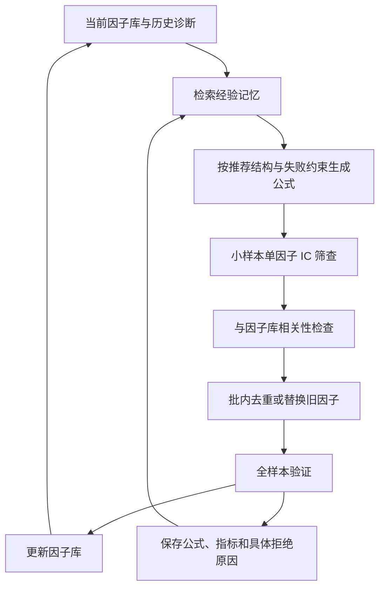
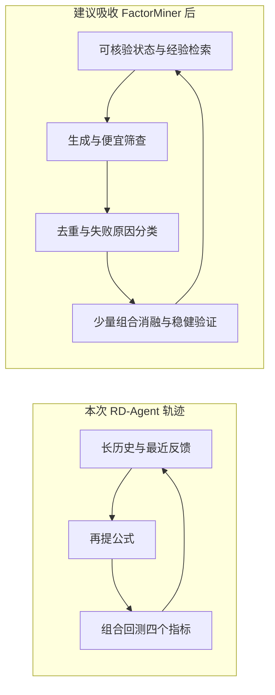

# FactorMiner：对 RD-Agent 当前轨迹缺陷的适用性分析

> 形态：Single-Agent；应用：Alpha 因子挖掘、量化研究自动化；机制：经验记忆、搜索、程序评估。
>
> 基于用户提供的 12 页 v2 PDF，并对照 2026-10-20～21 的 36 轮实际运行审计。本文是可迁移性判断，没有实施代码改造或重新跑因子。

## 缺口

这篇论文与本次问题高度相关：它研究的正是因子库扩大后，Agent 反复生成同类信号、历史试验不能转化为搜索约束的问题。最值得迁移的是经验记忆与分阶段筛查，预期首先改善单位预算的研究效率。

但它优化的是满足单因子质量与两两相关约束的因子库；当前 RD-Agent 要判断新因子加入 Alpha20 与 LightGBM 后是否改善预测和交易。两者目标有交集，不能互换。对“错误归因、统计显著性不足、组合贡献不清”等问题，论文没有给出完整解法。

## 增量

### 一句话

把每轮经历提炼成可检索的成功结构与失败约束，再用程序化验证限制生成，而不是让 Agent 每次重读长历史、凭文字解释决定下一步。

### 核心机制

它像一个有实验登记制度的研究团队：不仅保留实验日志，还把“哪个配方与已有结果重复、哪个结构在何种条件下通过”做成索引。下次选题先查询索引，便宜的检查先做，昂贵实验留给值得研究的候选。

### 关键概念

经验记忆并非所有历史的摘要。§3.3 将它分为矿业状态、成功/失败结构和战略经验；失败约束主要来自与现有因子库高度相关的区域。检索时结合当前因子库状态与近期拒绝原因。

“相关性红海”是指很多不同外观的公式输出了相近信号。§3.1 对相关性采用逐时点横截面 Spearman 相关的时间平均，入库条件使用其绝对值。它能识别反向信号的冗余，但两两低相关仍不等于对已有模型有条件增量。

技能是可执行评估接口。论文将 60 多个算子及验证流程封装为工具，模型提出表达式，工具计算指标。RD-Agent 已有代码执行和规则采纳，因此这里的增量主要是标准算子、分层诊断及结构化拒绝原因，而非首次实现“程序算指标”。

## 与实际运行逐项对照

| 本次问题 | 论文机制 | 预计帮助 | 必须补充的条件 |
|---|---|---|---|
| 隔夜收益家族反复换窗，27 轮无新最优 | 成功模式、失败约束和饱和状态 | 较直接改善选题与重复探索 | 记忆绑定市场、标签、频率和父基线；另加冷却、停滞退出 |
| Loop_9 与 Loop_17 因子实际完全一致 | 绝对 Spearman 库间检查、批内去重 | 能提供数值拦截基础 | 检查全部历史候选及 Alpha20，不限已采纳库；加表达式化简 |
| 生成输入增长，但状态不一致 | 检索相关经验、全局因子库视角 | 有望压缩上下文并统一状态 | 入库清单必须由程序维护，不能只靠自然语言记忆 |
| 79 个候选基本均进入组合评估 | 快速 IC、相关性、批内去重、全量验证 | 可减少无效完整回测 | 单因子 IC 仅做分流，保留可能有条件增量的候选 |
| 一次加入三因子，不知道谁贡献 | 逐因子 IC 与相关性轨迹 | 改善信息，但仍不足以归因 | 固定模型的逐项消融、配对种子、删减实验 |
| 因子库只增不减 | 高质量相关因子替换旧因子 | 提供替换路径 | 替换最终由组合净增量决定，不照搬单因子 IC 比值 |
| 猜测被升级为确定的失败原因 | 从反馈蒸馏经验 | 既可能帮助，也可能固化错误 | 事实与猜测分层；只有可复核证据生成硬约束 |
| 获胜 IC 的区间仍包含零 | 冻结因子、后期样本验证 | 验证纪律值得借鉴 | 多重试验、配对不确定性和训练种子变化仍须另做 |

### 1. 经验记忆最适合解决重复探索，但不能把所有失败写成禁区

实际案例：Loop_31～33 的反馈又建议 Amihud 家族，生成器随后指出此前已经尝试；隔夜方向在 Loop_28～29 中经历 20 日、60 日再建议缩回 20 日的解释反复。

可迁移做法：每个候选写入公式、家族、数据版本、目标周期、父基线、单因子指标、最近相关因子、组合增量、拒绝代码和证据路径。下一轮只检索与当前主题相关的记录，加一份程序生成的真实因子库快照。

例如 Loop_17 的记忆可以明确写成：“市场相对五日反转与 Loop_9 完全一致，共同面板最大差为零。”这是硬事实。Loop_19 则只能记录：“两因子组合 IC 下降；量比分母不稳定是待验证原因。”不能把它蒸馏成“量比分母导致失败”。

论文的禁止方向主要是冗余，不是因果诊断。迁移时应区分精确重复、高相关、组合无增量、实现失败和证据不足；对后四者的处理也不能简单相同。还应设置冷却与过期条件，避免记忆永久封死尚未独立检验的家族。

### 2. 相关性检查可拦重复，但论文原机制并不自动覆盖失败候选

实际案例：Loop_9 是 `PctRank(-R5)`，Loop_17 是 `PctRank(mean_t(R5)-R5)`。两者在截至 2022 年底 1,951,100 条共同观测上完全相同。当前去重主要对已采纳的新因子进行比较，因此没有拦住。

FactorMiner 的绝对 Spearman 检查优于当前只取正向 Pearson 最大值的实现，但其主要比较对象也是当前入库集合。由于 Loop_9 没入库，仅照搬这个检查，仍可能漏掉 Loop_17。

因此要同时迁移“记忆”和“检查”，并增加全历史候选指纹。对同一父基线下的精确重复直接跳过；父基线改变时允许预注册重评。训练面板和表达式化简足以完成此检查，不必查看最终保留期表现。

### 3. 分阶段筛查可以节约计算，但不要误杀有条件价值的因子

论文 Algorithm 1 的顺序是小资产子集单因子 IC、库间相关、批内去重、完整验证；不会给所有公式都做完整下游模型实验。

本次可改成“公式与数据契约检查 → 训练/研究验证期单因子诊断 → 历史去重 → 条件增量诊断 → 少量候选进入 Qlib 配对实验”。Loop_17 的重复因子在第二个数值关口就可退出，Loop_26 的成交量约分则应更早由语义检查拦截。

但 Alpha20+LightGBM 可以使用非线性交互，单因子边际 Rank IC 很低的特征仍可能在条件下有用。反过来，一个单因子 IC 很高但已有特征能重建的信号也可能无增量。应保留有限的条件信号测试通道，而不是照搬论文 0.04 的硬门槛。

### 4. 搜索结构值得借鉴，论文里的成功清单不能当作本机先验事实

论文 Table 6 推荐将 Skew/Kurt 用作状态条件、将 Rsquare 用于趋势可靠性切换，而不是只把它们当独立因子。附录的 081 等公式展示了条件式结构。

本次 Loop_21 将 beta、偏度、峰度作为独立排名因子，组合未通过。这没有否定“用峰度作为反转信号的环境条件”。一个值得预注册的新实验是：先固定既有反转信号，再比较是否按波动状态启用，以及这种启用是否产生跨窗口的条件增量。该实验是由论文启发的建议，尚无本机结果。

它比继续把隔夜窗口从 20 改成 60 更有机制上的差别。不过 LightGBM 原本就能表达部分条件关系，而且 Alpha20 已有 RSQR、RESI 等特征，必须检查实际新增信息。不能因论文叫它“推荐方向”便认定在本机也新颖有效。

### 5. 替换机制有用，仍需补组合消融

论文 Stage 2.5 允许高质量但与某个旧因子高度相关的新因子替换它，解决库只能累加的问题。

对 Loop_8 的 A/B/C 获胜组合，可以比较保留 A、更换为 A'、删除 A 三种状态，固定 B/C 与其他设置。这样知道是替换有用、删除更好，还是没有证据支持变化。

论文按单因子质量的替换规则不能直接替代这个比较。当前问题是加入 LightGBM 后的组合增量，必须在该模型和交易目标下验证。普通 XGBoost feature importance 也不能替代去一消融。

## 实验证据有多强

最有针对性的是 §4.3 与 Figure 3 的记忆消融：在该实验较宽松的 `|IC|>0.02`、相关阈值 0.85 下，有记忆生成 96 个达 IC 门槛候选，无记忆为 32 个；最终入库分别为 43 和 18。达标比例从 20% 到 60%，是论文支持“搜索先验有用”的直接证据。

但三倍指的是达 IC 门槛候选数；最终入库数约为 2.39 倍，不能说成组合收益或本机增量提高三倍。主实验入库阈值是 IC 0.04、相关阈值 0.5，与消融条件不同。图中也没有给出重复运行误差条，不能据此确定迁移到当前设置后的效应大小。

§4.1～4.2 还有一个值得采用的纪律：在 CSI500 的 2024 年数据上选择 Top40，冻结后在 2025 年跨市场评估。这个设计比边看最终测试结果边调整规则更清楚。

性能数字不能横比：论文主要是 10 分钟数据、下一根 10 分钟收益，IC 指 Spearman，Table 1 还采用绝对均值摘要；本机是日频标签，主门槛针对 LightGBM 组合预测 Pearson IC。论文 8.25% 与本机 0.015748 不在同一实验口径。论文也没有给出与本机 RD-Agent 的同设置直接对照。

## 餐巾纸速写

关键位移在于：先用证据决定还有什么值得试，再给剩下的候选分配完整实验预算。

## 博导审稿

选题很贴切，尤其针对公式库逐渐饱和后的冗余搜索。论文把问题具体化为记忆、算子和入库流程，提供了明确的系统设计和记忆消融，值得认真借鉴。

方法的“自进化”是检索、生成与经验更新，没有更新 LLM 权重。§3.3 的 Formation/Evolution/Retrieval 仍有较多概念性描述，本文没有给出足以自动保证记忆正确性的因果检验、置信度治理或详细失效恢复机制。若输入反馈已有错误，记忆可能让错误更持久。

论文的主要目标仍是 IC、ICIR 和两两去冗余。§6～7 明确将含交易成本的部署回测留待未来。因此它无法直接解决 Loop_34 的交易净收益与 IC 分歧，也没有解决本次唯一赢家的统计不确定性。没有看到针对多重自适应试验的完整校正流程，或者可以替代组合消融的证据。

还有可复现口径需核对：Algorithm 1 使用绝对 IC 和一般质量改进条件，附录式 (11) 则使用 IC 0.10、相对旧因子 1.3 倍及正向相关集合；实现时必须统一符号与绝对值。算子类型检查也不能自动保证金融量纲和经济解释正确。

**判决：weak accept，针对本项目的工程借鉴价值较高；作为“已解决日频组合收益与研究可靠性”的证据不足。** 这是本次阅读的技术判断，不是会议审稿结论。

## 启发与建议顺序

迁移：最先接入带证据路径的经验账本、当前因子库状态、全历史精确去重。它们直接针对 Loop_9/17 的重复和 Loop_31～33 的历史纠错。

混搭：保留 Qlib 的实际组合与含成本回测，将 FactorMiner 风格的诊断前置为筛查层，再加入配对消融和时间窗不确定性。论文补搜索组织，本机保留真实下游目标，另补两者都不足的证据纪律。

反转：当前每次失败都在问“下个公式是什么”。论文提示先问“失败是单因子弱、与库重复、还是完整验证不过”。只有第三类涉及当前组合时，才进入对应的模型与交易诊断。

建议最小验证分开两步：先用既有账本回放，检查是否拦住 Loop_9/17、真实保留未入库状态、避免无证据因果记忆；再固定模型、数据、预算和主目标，做关闭/开启记忆的对照试验。回放能证明拦截逻辑，不会证明后续生成的收益改善。正式试验比较重复率、每单位费用的非重复有效候选数、完整回测次数和稳健组合增量，不能只数因子库大小。

本次按 ljg-paper 的机制与证据审查流程编写；其配置的旧 Obsidian 目录不存在，分析保存于当前项目研究目录。PDF 关键图表与附录条件已视觉核对，原文中的提示性文字仅作为论文内容处理。

## 来源

- 用户提供的本地 PDF：`C:/Users/27898/AppData/Local/Temp/Zotero/drag-1/Wang 等 - 2026 - FactorMiner A Self-Evolving Agent with Skills and Experience Memory for Financial Alpha Discovery.pdf`，完整阅读 12 页。
- [arXiv v2](https://arxiv.org/abs/2602.14670v2)：核对论文身份与版本。
- [此前实际运行审计](审计报告.md)及其链接的签名工件与数值核对。
